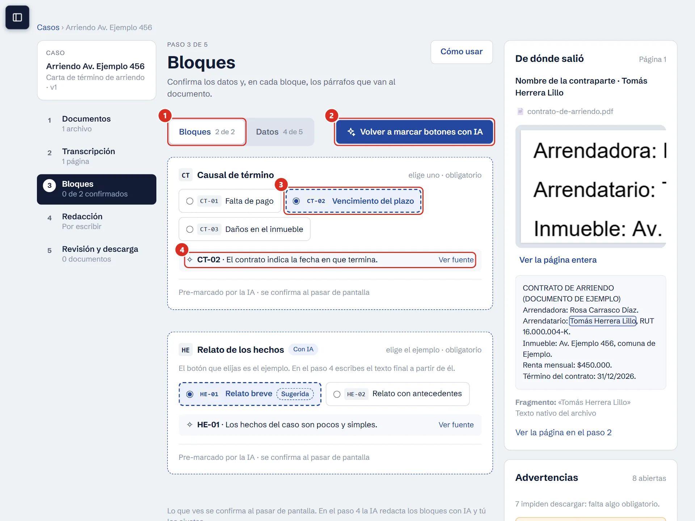
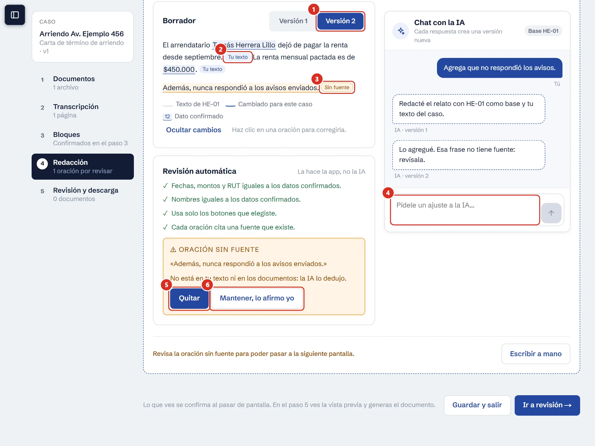
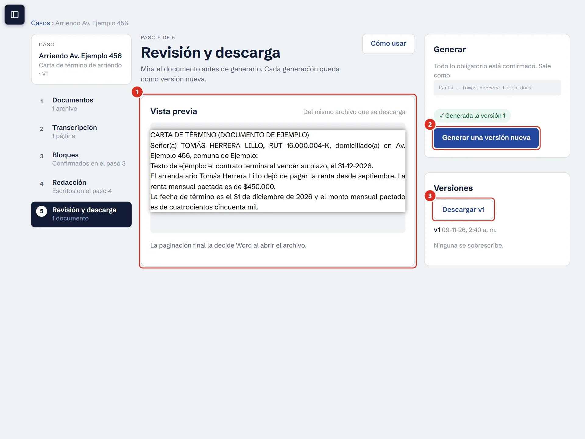

**Full-stack developer · Santiago, Chile 🇨🇱** 
Construyo software y automatizaciones con IA para negocios bajo la marca **snglw.** 
*I build software and AI automations for businesses under the **snglw.** brand.*

---

### 🛠️ Stack

  

### 🚀 Proyectos destacados · Featured projects

| Proyecto | Qué es | Stack |
|---|---|---|
| [**Apto**](https://github.com/Snglw08/Apto-app) · [demo mobile-app](https://apto-app.snglwdesign.workers.dev) | Escáner de etiquetas: el paciente escanea un producto y recibe un veredicto (recomendado / neutro / no recomendado) según las reglas que definió su nutricionista, con OCR cuando faltan datos. Versión de portafolio de un MVP que desarrollé para un cliente real. · *Label scanner that tells patients if a product fits their nutritionist's rules. Portfolio version of a client MVP.* | Next.js 16 · TypeScript · Supabase · Cloudflare Workers · Gemini |
| [**snglw-site**](https://github.com/Snglw08/snglw-site) | Mi sitio web bilingüe. · *My bilingual website.* | Astro |
| **escritIA** · _repo privado · private repo_ | SaaS multi-estudio para estudios jurídicos que arma documentos a partir de plantillas Word. Lee los archivos del caso (PDF, Word, Excel, fotos) con OCR y extracción con IA, propone datos y párrafos con la fuente de cada uno, y el abogado confirma. El documento se arma de forma determinista, y los textos que redacta la IA se revisan oración por oración contra sus fuentes. Aislamiento total entre estudios con RLS, colas de trabajo, roles, auditoría, planes y panel de plataforma. En producción con un estudio piloto. · *Multi-tenant SaaS for law firms that assembles documents from Word templates. AI reads case files, proposes data and drafts with a source for every claim, the lawyer confirms, and the document is built deterministically. Per-firm isolation via RLS, job queues, roles, audit log and billing plans. Live with a pilot firm. Code is private; happy to walk through it.* | Next.js (App Router) · TypeScript · Cloudflare Workers + Queues · Supabase (Postgres, RLS, Auth, Storage) · Gemini · Zod · docxtemplater · Vitest · Playwright · pnpm monorepo · Docker (Supabase local) |

#### 🖼️ escritIA en acción · escritIA in action

*El código es privado, pero así se ve. Capturas con datos ficticios. · The code is private, but this is how it looks. Screenshots use fictitious data.*

| 1 · La IA propone, con su fuente | 2 · Borrador revisado por la app | 3 · El documento se arma solo |
|---|---|---|
|  |  |  |
| Cada dato y cada botón sugerido muestra el archivo, la página y el fragmento. El abogado confirma. · *Every suggestion shows file, page and quote. The lawyer confirms.* | Fechas, montos y nombres se comparan con los datos confirmados; lo que no tiene fuente se marca. · *Dates, amounts and names are checked against confirmed data; unsourced claims get flagged.* | Mismas entradas, mismo documento: el armado es determinista y cada versión queda guardada. · *Same inputs, same document; every version is kept.* |

### 🔥 Actividad

  

💼 **Disponible para proyectos freelance** · *Open to freelance work*

